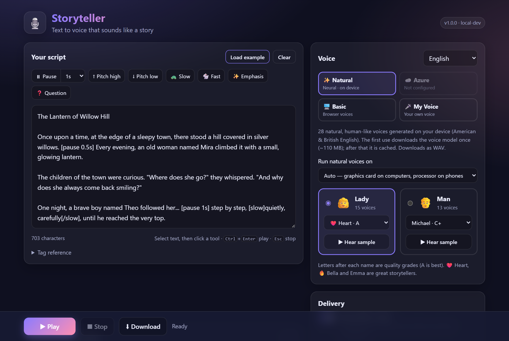
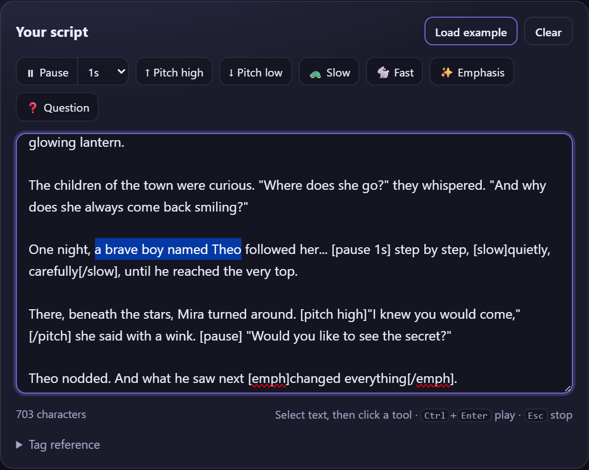
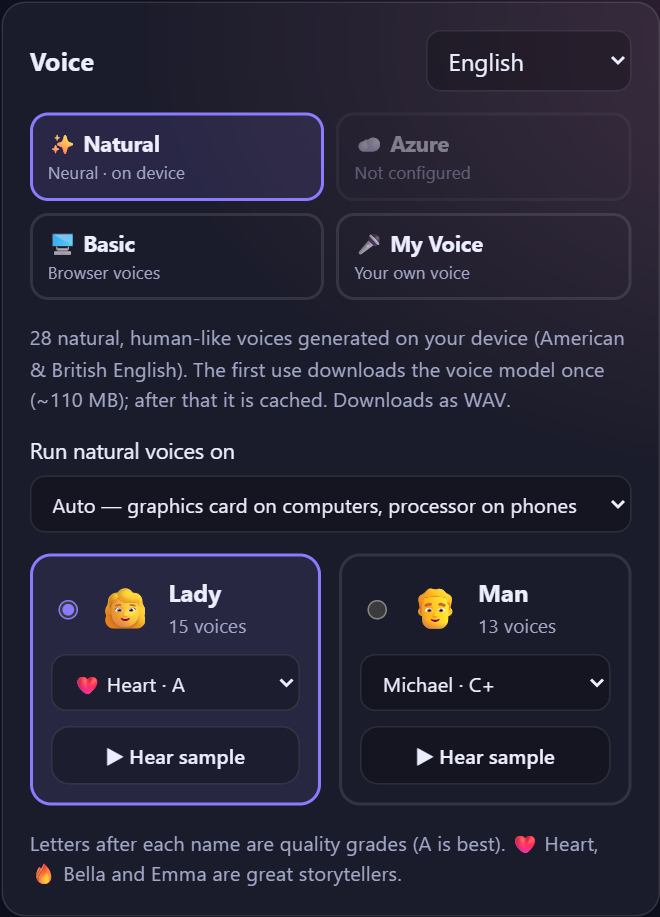
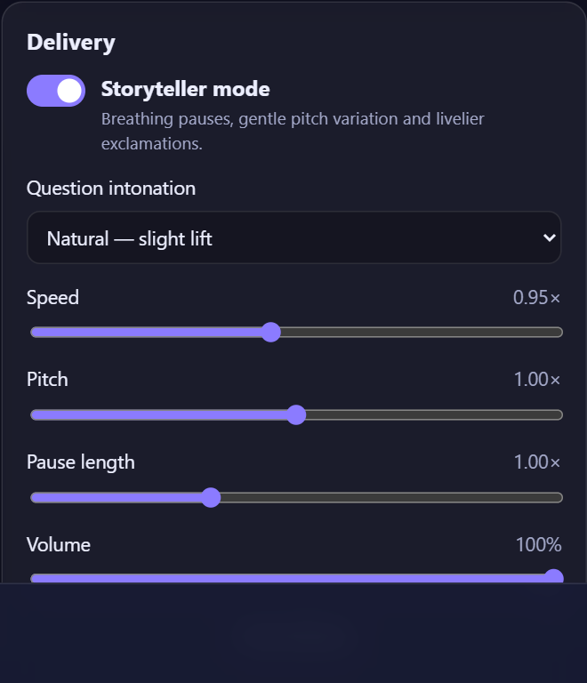
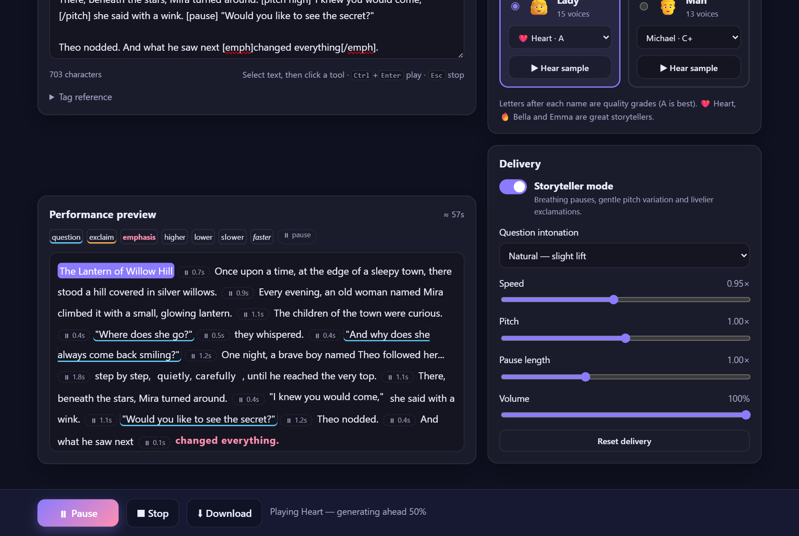
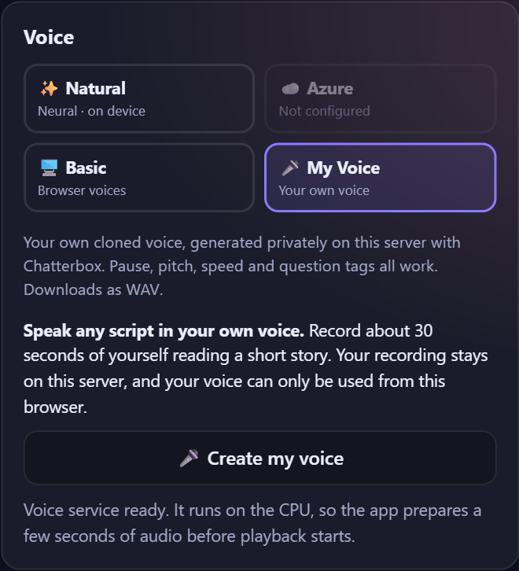
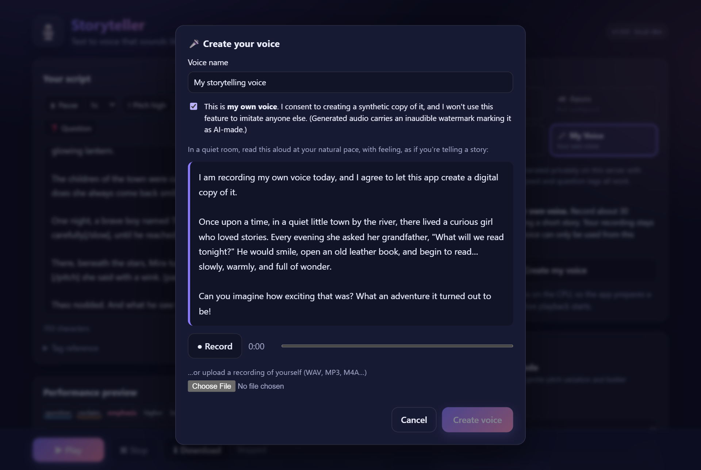
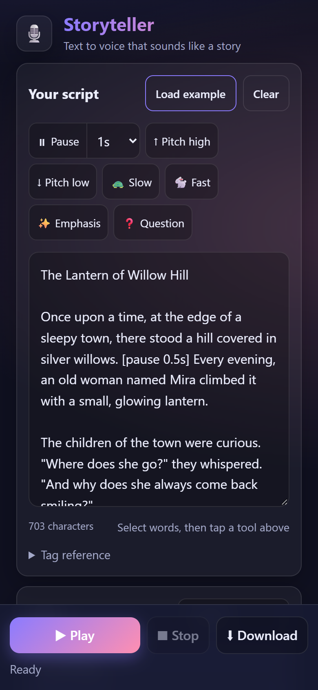
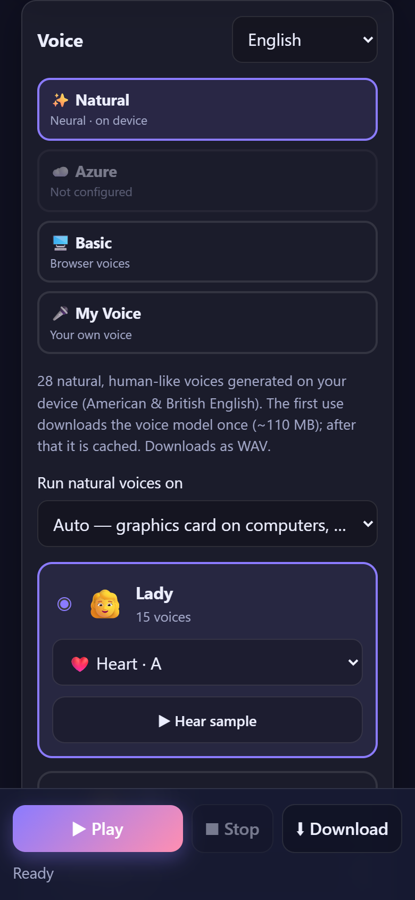

# 🎙️ Storyteller — Text to Voice

Type a story and hear it read aloud by a natural voice, or **in your own voice**. Add pauses and questions, then
download it as an audio file. It works on computers and phones.



---

## 📖 How to use

### 1. Write your script
Type or paste your text into **Your script**, or click **Load example** to try a short story.

To add expression, **select some words** and tap a tool:
⏸ **Pause** · ↑ **Pitch high** · ↓ **Pitch low** · 🐢 **Slow** · 🐇 **Fast** · ✨ **Emphasis** · ❓ **Question**.
The tool wraps your selection in a small tag such as `[slow]…[/slow]`. You can also type tags yourself.



### 2. Choose a voice
At the top of **Voice**, pick a voice type:

| | |
| --- | --- |
| ✨ **Natural** | Human-like voices. Free, and they run on your device. *(Recommended)* |
| 🎤 **My Voice** | Speaks in **your own voice** (see step 5) |
| ☁️ **Azure** | 400+ voices and languages (needs an Azure key) |
| 🖥️ **Basic** | Your browser's built-in voices (robotic) |

Then choose 👩 **Lady** or 👨 **Man**, pick a voice from the list, and tap **▶ Hear sample** to listen.
The letter after each name is a quality grade (**A** is best).



### 3. Adjust the delivery (optional)
- **Storyteller mode** adds natural breathing pauses and livelier expression.
- **Question intonation** changes how questions rise at the end.
- Change **Speed**, **Pitch**, **Pause length** and **Volume**. **Reset delivery** restores the defaults.



### 4. Play and download
Tap **▶ Play**. The **Performance preview** highlights each sentence as it's spoken and shows every pause.
Tap **⬇ Download** to save the audio (WAV, or MP3 for Azure voices).



### 5. Use your own voice 🎤
1. Choose **🎤 My Voice**, then tap **Create my voice**.
2. Type a name and tick the consent box (it must be **your own** voice).
3. Tap **● Record** and read the passage on screen for **20–30 seconds** in a quiet room. You can also upload a
   recording of yourself.
4. Tap **Create voice**. In about a minute, everything you type plays in your voice.





> 💡 For the best result, start speaking right away and read with the feeling you want, such as warmly or like a
> storyteller. The clone copies your style.

### 📱 On a phone
The same app adapts to small screens:

<p>
  
  &nbsp;
  
</p>

To **record your voice** on a phone, open the app through an `https://` address (see
[On your phone](#-on-your-phone) below).

---

## 🚀 Start it (5 minutes)

1. Install **[Docker Desktop](https://www.docker.com/products/docker-desktop/)** and open it.
2. Open a terminal and run:
   ```powershell
   git clone https://github.com/ttolaaa/text2voice_app.git
   cd text2voice_app
   copy .env.example .env
   docker compose up -d --build
   ```
3. Open **http://localhost:8080** in your browser.

The first start takes a while because it downloads the voice models. After that it starts in seconds.

---

## 📱 On your phone

The app works in Safari and Chrome on phones. To **record your voice**, though, the page must use **https://**
(browsers block the microphone on plain `http://`). The easiest way to test from your PC:

1. In VS Code, open the **Ports** tab (next to *Terminal*) and click **Forward a Port**. Enter `8080`.
2. Right-click it and choose **Port Visibility → Public**.
3. Open the `https://…` address on your phone.

For a permanent address, put it on a server (next section).

---

## 🌍 Put it online (with HTTPS)

On a Linux server with a domain name (e.g. `voice.example.com`):

1. Point the domain's DNS **A record** to your server, and open ports **80** and **443**.
2. Run:
   ```bash
   curl -fsSL https://get.docker.com | sh
   git clone https://github.com/ttolaaa/text2voice_app.git && cd text2voice_app
   cp .env.example .env
   ```
3. Edit `.env` and add:
   ```ini
   COMPOSE_PROFILES=https
   DOMAIN=voice.example.com
   TRUST_PROXY=1
   PORT=127.0.0.1:8080
   ```
4. Run `docker compose up -d --build`, then open **https://voice.example.com**. The HTTPS certificate is set up
   automatically.

---

## 🛠️ Useful commands

| What | Command |
| --- | --- |
| Start | `docker compose up -d` |
| Stop | `docker compose down` |
| See if it's running | `docker compose ps` |
| See logs | `docker compose logs -f` |
| Update to the latest code | `git pull` then `docker compose up -d --build` |
| Save and publish your changes | `git add -A` → `git commit -m "message"` → `git push` |

---

## ❓ Problems?

| Problem | Fix |
| --- | --- |
| **Create voice** button is grey | Enter a name, tick consent, and record at least 10 seconds. |
| Can't record on a phone | Use an `https://` address (see *On your phone*) and allow microphone access. |
| "My Voice service is starting…" | The first start downloads ~4 GB. Wait a few minutes. |
| Port 8080 is busy | Put `PORT=9000` in `.env`, then open http://localhost:9000. |
| `git push` says *No configured push destination* | Run `git remote add origin <your-repo-url>`, then `git push -u origin main`. |

---

## ⚙️ Settings (optional)

Put these in the `.env` file, then run `docker compose up -d`:

| Setting | What it does |
| --- | --- |
| `PORT=8080` | Which port the app uses |
| `AZURE_SPEECH_KEY=…` and `AZURE_SPEECH_REGION=…` | Turn on ☁️ Azure voices |
| `CLONE_URL=` | Leave it empty to turn off My Voice |
| `COMPOSE_PROFILES=https` and `DOMAIN=…` | Turn on automatic HTTPS |

<details>
<summary><b>More details (for developers)</b></summary>

### What runs
- **text2voice**: the web app (Node.js) on port 8080.
- **voice-clone**: the My Voice service (Chatterbox). It's private and only the app can reach it.
- **caddy** *(optional)*: the HTTPS proxy, which only starts when `COMPOSE_PROFILES=https` is set.

You need about **12 GB of free disk** and **8 GB of RAM** (16 GB recommended for My Voice).

### Faster My Voice with an NVIDIA GPU
```bash
docker compose -f docker-compose.yml -f docker-compose.gpu.yml up -d --build
```

### More settings
`CLONE_MODEL=turbo|standard` (standard is slower but adds an *Expressiveness* slider) ·
`CLONE_DEVICE=auto|cpu|cuda` · `AZURE_REQUESTS_PER_MINUTE` · `AZURE_CHARS_PER_HOUR`

### Text tags
You can type these instead of using the toolbar:
`[pause 1s]` · `[pitch high]…[/pitch]` · `[slow]…[/slow]` · `[fast]…[/fast]` · `[emph]…[/emph]` · `[ask]…[/ask]`

### Auto-deploy on every commit
Run `git config core.hooksPath .githooks` once. After that, every commit runs the tests and restarts Docker with the
new code. GitHub Actions also builds the images on every push.

### Back up cloned voices
```bash
docker run --rm -v text2voice_clone-voices:/data -v "$PWD":/backup alpine tar czf /backup/voices-backup.tgz -C /data .
```

### Run without Docker
```powershell
node scripts/fetch-assets.mjs   # one time: downloads the voice models
node server/index.js            # http://localhost:8080
node --test                     # run the tests
```

### Privacy
Natural voices run in your browser. My Voice recordings stay on your server and can only be used from the browser
that created them. Every cloned clip carries an inaudible AI watermark. Azure voices send text to Microsoft Azure.

### Project layout
`public/` web app · `server/` Node.js server · `voice-clone/` My Voice service · `scripts/` setup and deploy
helpers · `tests/` unit tests

**Licences:** Kokoro-82M and kokoro-js (Apache-2.0), Chatterbox (MIT), onnxruntime-web (MIT).

</details>
